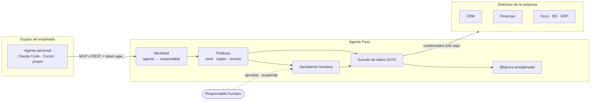

# Agente Pass

[English](README.md) · **Español**

**BYOA responsable: invita a los agentes de IA de tu equipo a trabajar con los sistemas de la empresa, bajo tus reglas.**

Tus empleados ya usan agentes de IA: Claude Code, Cursor, ChatGPT, agentes que corren en su propio computador. Y cada vez más proveedores y clientes quieren que sus agentes trabajen contigo. Prohibirlos no los elimina, los vuelve invisibles.

Agente Pass hace lo contrario. Los invita a entrar por una sola puerta, con **una persona que responde por cada agente**:

- El agente nunca recibe contraseñas ni llaves de la empresa. Solo tiene un token que sirve en Agente Pass.
- Cada llamada pasa por tus reglas. Lo delicado espera la firma de una persona.
- Los datos sensibles se ocultan antes de llegar al modelo de IA del agente.
- Todo queda en una bitácora a prueba de alteraciones.

> **BYOA** (Bring Your Own Agent): el empleado trae su agente, la empresa pone las reglas y una persona responde por él.

## Mira la demo

Recorrido de 72 segundos por la consola: Camila (jefatura) firma un pago que propuso un agente, Sofía (seguridad) revisa los agentes ya conectados a Google Workspace y Microsoft 365, e Ignacio (empleado) inscribe el ChatGPT al que lo invitaron. Google y Microsoft son simulados; el resto es el producto funcionando.

[Ver el video](docs/demo/agente-pass-demo.mp4) · [Lo que vive el agente en la terminal](docs/demo/terminal.txt)

| Firma de la jefatura | Agentes ya conectados | Invitación a inscribir |
|---|---|---|
|  |  |  |

## Pruébalo en 2 minutos

Necesitas Node.js 22.13 o superior.

```bash
git clone https://github.com/nachodev10/agent-gateway.git
cd agent-gateway
npm install
npm run demo
```

La demo levanta Agente Pass con dos sistemas de ejemplo (un CRM y uno de finanzas), crea un equipo ficticio, inscribe el agente de Ignacio y simula su primera sesión:

```text
→ Lectura: el RUT llega redactado (requiere autorización restringida)
  "rut": "[REDACTADO:rut]"
→ Acción prohibida por política
  Acción bloqueada por la política de Empresa Demo SpA: Ningún agente elimina fichas de clientes...
→ Pago alto: lo aprueba la jefatura
  Acción en espera de aprobación humana (solicitud apr_…)
```

Después abre `http://127.0.0.1:8080` y entra con uno de los tokens que imprime la demo (Camila es la jefatura, Sofía es seguridad, Ignacio es el empleado). La demo también imprime un comando para conectar tu propio Claude Code como si fueras el agente de Ignacio.

## Cómo funciona



En cada llamada:

1. **Identidad.** El token identifica al agente y a su responsable. Si el agente está suspendido, el responsable dejó la empresa o venció su recertificación, el acceso se corta en el acto.
2. **Catálogo a la medida.** El agente solo ve las herramientas que puede usar.
3. **Política.** Sistemas autorizados → techo de clasificación de datos → reglas de la empresa → nivel de confianza.
4. **Humano en el circuito.** Lo consecuente (pagos, correos externos, escrituras en período de prueba) espera al responsable, su jefatura o seguridad.
5. **Escudo de datos.** El resultado se redacta según la autorización del agente antes de llegar al modelo del empleado.
6. **Bitácora.** Todo queda registrado, atribuido al agente y a su responsable, en una cadena de hashes verificable.

Agente Pass habla [MCP](https://modelcontextprotocol.io) (Model Context Protocol): cualquier cliente MCP se conecta con una URL y un encabezado. Los agentes que no hablan MCP usan la API REST.

## Qué incluye

| Función | Qué significa |
|---|---|
| Una sola puerta | Las credenciales de la empresa viven solo en Agente Pass. El agente nunca las tiene. |
| Una persona por agente | El empleado inscribe su agente y acepta un acuerdo de uso. Nadie aprueba su propio agente. |
| Niveles de confianza | Observador, Asistente, Colaborador, Autónomo. Los agentes parten con poco y ganan autonomía. |
| Techo por proveedor de modelo | Un agente con suscripción personal de IA nunca ve datos confidenciales. |
| Políticas como código | Reglas en un archivo YAML, revisadas en git como cualquier código. Una regla nueva puede partir en modo observación. |
| Firma humana | Las aprobaciones valen una sola vez y para los argumentos exactos. |
| Escudo de datos | Oculta secretos, tarjetas, RUT, correos y teléfonos según la autorización. Avisa de instrucciones escondidas en los datos (inyección de prompts). |
| Suspensión inmediata | Hay intentos que no merecen otra oportunidad: el agente se suspende al primero. |
| Descubrimiento | Encuentra agentes de IA y automatizaciones ya conectados a Google Workspace y Microsoft 365, para que seguridad invite a sus dueños a inscribirlos. |
| Pasaporte del agente | Una credencial firmada (JWT) que cualquier sistema verifica con la clave pública de Agente Pass. |
| Delegación por llamada | Cada llamada lleva un token firmado que dice por qué persona actúa el agente (delegación OAuth, RFC 8693). |
| Credenciales temporales | Las credenciales pueden venir de HashiCorp Vault u OpenBao y duran minutos. |
| Agentes de terceros | Agentes de otras empresas, patrocinados por un empleado, con topes más estrictos y tokens ligados a su clave (DPoP, RFC 9449). |
| Ciclo de vida | Tokens que vencen y rotan, recertificación periódica, botón rojo y una desvinculación que corta todos los agentes de la persona. |
| Consola web | Monitorear, aprobar, suspender e inscribir agentes. |

Lo que está construido, a medias y pendiente está en [docs/estado.md](docs/estado.md).

## ¿Quieres ayudar?

No necesitas ser experto en seguridad. Hay tareas pequeñas y acotadas que suman mucho, por ejemplo:

- **Traducir la consola web al inglés** (`public/app.js` es JavaScript sin paso de build).
- **Agregar un detector de datos** para un documento de tu país, como el RFC de México, el CPF de Brasil o el DNI de Argentina (`src/dlp.ts`).
- **Enseñarle al descubrimiento nuevas apps de IA** (`src/discovery.ts`, es una lista de nombres).
- **Agregar patrones de inyección de prompts** en tu idioma (`src/guardrails.ts`).
- **Probarlo con Cursor o VS Code** y contarnos qué pasó.

Parte por [CONTRIBUTING.es.md](CONTRIBUTING.es.md): explica el proyecto en 5 minutos, cómo correr las pruebas y cómo enviar tu primer pull request. Issues y pull requests son bienvenidos en español o en inglés.

---

## Referencia

### Conectar el agente de un empleado

El responsable emite el token desde la consola (o `POST /api/agents/:id/tokens`) y lo configura en su agente.

Claude Code:

```bash
claude mcp add --transport http empresa https://agentes.miempresa.cl/mcp \
  --header "Authorization: Bearer agw_…"
```

Archivo `.mcp.json` (Claude Code; otros clientes MCP usan una configuración equivalente con URL y encabezado):

```json
{
  "mcpServers": {
    "empresa": {
      "type": "http",
      "url": "https://agentes.miempresa.cl/mcp",
      "headers": { "Authorization": "Bearer agw_…" }
    }
  }
}
```

Agentes sin MCP:

```bash
curl -H "Authorization: Bearer agw_…" https://agentes.miempresa.cl/v1/tools
curl -X POST https://agentes.miempresa.cl/v1/tools/crm_buscar_clientes/call \
  -H "Authorization: Bearer agw_…" -H "Content-Type: application/json" \
  -d '{"arguments": {"texto": "andes"}}'
```

Respuestas REST: `200` ejecutada, `202` en espera de aprobación, `403` bloqueada, `502` error del conector.

### En tu entorno

```bash
export AGW_ADMIN_TOKEN="$(openssl rand -base64 32)"
AGW_CONFIG=config/gateway.yaml npm run dev        # desarrollo

npm run build
NODE_ENV=production npm start                     # producción (exige AGW_ADMIN_TOKEN)
```

Con Docker (monta tu configuración y un volumen para la base y la llave de firma):

```bash
docker build -t agent-gateway .
docker run -p 8080:8080 -e AGW_ADMIN_TOKEN="$AGW_ADMIN_TOKEN" \
  -v "$PWD/config/gateway.yaml:/app/config/gateway.yaml:ro" -v agw-data:/app/data agent-gateway
```

Un conector que no responde no bloquea el arranque: queda marcado como desconectado y se reintenta cada 30 segundos.

Alta de personas (en producción vendrán del proveedor de identidad):

```bash
curl -X POST localhost:8080/api/people -H "Authorization: Bearer $AGW_ADMIN_TOKEN" \
  -H "Content-Type: application/json" \
  -d '{"name": "Camila Rojas", "email": "camila@miempresa.cl", "department": "comercial"}'

curl -X POST localhost:8080/api/people/<id>/tokens -H "Authorization: Bearer $AGW_ADMIN_TOKEN"
```

### Políticas

Todo vive en [`config/gateway.yaml`](config/gateway.yaml). Los secretos de los conectores se referencian como `${VARIABLE}` y se leen del entorno. Una clave mal escrita es un error al iniciar, no un permiso silencioso.

```yaml
rules:
  - id: pagos-altos-con-jefatura
    description: Pagos sobre $500.000 los aprueba la jefatura del responsable (cuatro ojos).
    when:
      connectors: [finanzas]
      tools: [emitir_pago]
      args:
        - { path: monto, op: gt, value: 500000 }
    effect: require_approval
    approver: manager

  - id: finanzas-solo-areas-autorizadas
    when: { connectors: [finanzas] }
    unless: { departments: [finanzas, comercial] }
    effect: deny
```

Precedencia: límites duros (conector autorizado y clasificación) → `deny` → `require_approval` → `allow` → comportamiento por defecto del nivel.

| Condición (`when` / `unless`) | Ejemplo | Significado |
|---|---|---|
| `connectors` | `[crm]` | Conector de la herramienta |
| `tools` | `["eliminar_*"]` | Nombre de la herramienta (admite `*` y `?`) |
| `access` | `[write]` | `read`, `write` o `destructive`, según las anotaciones MCP. Sin anotaciones se asume `destructive` |
| `tiers` | `[0, 1]` | Nivel del agente |
| `departments` | `[finanzas]` | Área del responsable |
| `agents` | `[agt_…]` | Agentes específicos |
| `origins` | `[third_party]` | Agente de un empleado o de un tercero |
| `organizations` | `[Acme]` | Organización del tercero |
| `outsideBusinessHours` | `true` | Fuera de `organization.businessHours` |
| `args` | `{ path: para, op: notMatches, value: "@miempresa\\.cl$" }` | `eq`, `neq`, `gt`, `gte`, `lt`, `lte`, `in`, `notIn`, `matches`, `notMatches`, `exists`. Si el valor es una lista, basta un elemento |

Niveles incluidos (configurables):

| Nivel | Lectura | Escritura | Destructiva | Datos hasta | Aprueba |
|---|---|---|---|---|---|
| 0 · Observador | sí | no | no | internos | jefatura |
| 1 · Asistente | sí | con aprobación | no | confidenciales | jefatura |
| 2 · Colaborador | sí | sí | con aprobación | confidenciales | jefatura |
| 3 · Autónomo | sí | sí | con aprobación | restringidos | seguridad |

La autorización final del agente es el mínimo entre su nivel y el techo de su proveedor de modelo (`modelProviders`).

### Guardrails

La política decide *si* un agente puede usar una herramienta. Los guardrails revisan *el contenido* de cada llamada:

| Etapa | Qué revisa | Ejemplo incluido |
|---|---|---|
| `before` | Los argumentos que envía el agente | Bloquear credenciales enviadas a un sistema |
| `after` | El resultado que recibirá el agente | Advertir instrucciones inyectadas en datos (un correo, un formulario, una ficha) |

Tipos de chequeo: `prompt_injection` (patrones en español e inglés), `regex` y `webhook` (un validador externo que responde `{ "verdict": true|false }`). Acción `deny` (bloquea) o `flag` (registra y, en `after`, antepone un aviso al resultado). `onError` decide qué pasa si el validador no responde.

Las reglas también aceptan `mode: observe`: se evalúan y quedan en la bitácora sin aplicarse, para medir el impacto de una regla antes de activarla.

### Suspensión inmediata

Una regla `deny` o un guardrail `deny` con `suspend: true` suspende al agente en el primer intento, sin esperar al cortacircuitos. Es para lo que ningún agente debería intentar nunca. En la configuración de ejemplo: enviar una credencial a un sistema o que un agente de terceros intente mandar correos a nombre de la empresa.

- El agente pierde el acceso en el acto, con todos sus tokens, y recibe el motivo.
- Queda un evento `agent.auto_suspended` con la regla o el guardrail que lo causó.
- Lo reactiva su jefatura o seguridad, nunca el propio responsable.
- En `mode: observe` solo se registra que habría suspendido.
- Un validador externo caído nunca suspende a nadie, aunque su `onError` bloquee la llamada.

### Descubrimiento de agentes ya conectados

Antes de invitar a los agentes hay que saber cuáles ya entraron. Agente Pass lee los accesos OAuth que cada persona dio en **Google Workspace** y **Microsoft 365**, reconoce los agentes de IA (ChatGPT, Claude, Copilot, Perplexity, Fireflies y otros) y las automatizaciones (Zapier, Make, n8n), y estima su riesgo por los permisos: enviar correo o escribir en todo el Drive es alto; leer correo o archivos, medio.

Nada se bloquea desde aquí. Seguridad decide:

- **Invitar a inscribir**: la persona ve la invitación en su consola y, al inscribir el agente, el acceso queda vinculado a su ficha.
- **Descartar**: por ejemplo, una automatización que TI ya aprobó.

Cada escaneo conserva esas decisiones y marca los accesos que ya no aparecen. Si un proveedor falla, no se toca lo suyo.

```yaml
discovery:
  intervalMinutes: 1440 # 0 = solo cuando seguridad lo pide
  agentNames: [contador pro] # nombres extra que cuentan como agentes de IA
  google:
    serviceAccount: "${GOOGLE_SERVICE_ACCOUNT_JSON}"
    adminEmail: ti@miempresa.cl
  microsoft:
    tenantId: "${MS_TENANT_ID}"
    clientId: "${MS_CLIENT_ID}"
    clientSecret: "${MS_CLIENT_SECRET}"
```

- **Google**: una cuenta de servicio con delegación de dominio y solo dos permisos de lectura, `admin.directory.user.readonly` y `admin.directory.user.security`, actuando a nombre de un administrador.
- **Microsoft**: una aplicación registrada con el permiso de aplicación `Directory.Read.All` y consentimiento de administrador. Las apps propias de Microsoft se omiten.
- **Prueba sin cuentas reales**: `npm run demo` usa un Google Workspace y un Microsoft 365 simulados (`examples/demo-clouds.ts`).

### Agentes de terceros

Un agente de otra organización (proveedor, consultora, cliente) entra igual que el de un empleado, con controles más estrictos:

| Control | Comportamiento por defecto (`thirdParty` en la configuración) |
|---|---|
| Patrocinador | Lo inscribe un empleado, que queda como su responsable interno |
| Aprobación | Solo Seguridad; nunca el propio patrocinador |
| Techo | Nivel máximo 1 (Asistente) y datos hasta `internal`, sin importar su proveedor de modelo |
| Credencial | Token ligado a la clave del agente (DPoP, RFC 9449): si el token se filtra, no sirve sin la clave privada, que nunca sale del tercero |
| Vigencia | Token de 7 días y recertificación cada 30 |
| Reglas | Condiciones `origins: [third_party]` y `organizations: [...]` para políticas específicas |

Flujo:

1. El tercero genera su clave y entrega solo la pública: `tsx examples/third-party-agent.ts keygen agente.key.json`.
2. El patrocinador inscribe el agente (tipo "Agente de un tercero") y Seguridad lo aprueba.
3. El patrocinador emite el token pegando la clave pública; el token queda ligado a ella.
4. El tercero se conecta firmando cada request: `AGW_TOKEN=agw_… tsx examples/third-party-agent.ts run agente.key.json`. Con el SDK de MCP basta con pasar `fetch: dpopFetch(token, clave)` al transporte HTTP.

### Pasaporte del agente

Agente Pass firma un **pasaporte** (JWT ES256) que dice quién es el agente, de qué organización viene, quién responde por él y qué tiene autorizado.

- Cada conector lo recibe en cada llamada en `_meta["agent-gateway/passport"]` y puede verificarlo con la clave pública de `/.well-known/jwks.json`.
- El agente obtiene el suyo en `GET /v1/passport` para presentarlo ante otros sistemas.
- `POST /passports/verify` verifica la firma y además informa si el agente sigue activo.
- Es de vida corta (15 minutos por defecto). La revocación real ocurre en Agente Pass, que valida el estado en cada request.
- La clave de firma se genera y guarda en la base, o se entrega con `AGW_SIGNING_KEY` (JWK privado) desde un gestor de secretos.

### Delegación por llamada

Además del pasaporte, cada llamada lleva un **token de delegación** firmado con la misma clave, con la forma de delegación de OAuth (RFC 8693): `sub` es la persona y `act` es el agente que actúa por ella. Vale para una sola acción.

- `aud` es el conector que recibe la llamada: otro sistema debe rechazarlo.
- `tool`, `access` y `args_sha256` dicen qué herramienta se autorizó y con qué argumentos exactos.
- `approval` aparece cuando la acción necesitó firma humana: quién firmó y con qué solicitud.
- Vence a los 120 segundos (`delegation.ttlSeconds`).
- Va en `_meta["agent-gateway/delegation"]` y, en conectores http con `delegationHeader`, también en esa cabecera. Su `jti` queda en la bitácora para cruzar los registros del sistema con los de Agente Pass.

Un conector lo verifica sin llamar a Agente Pass: firma ES256 con la clave de `/.well-known/jwks.json`, `typ` igual a `agent-delegation+jwt`, `aud` igual a su propio id y `exp` vigente.

### Credenciales temporales desde Vault

Las credenciales de los sistemas pueden venir de **HashiCorp Vault u OpenBao** en vez de quedar fijas en el entorno. Agente Pass las pide justo antes de usarlas y las reutiliza solo mientras dura su arriendo; con secretos dinámicos (bases de datos, nubes) cada credencial es única y Vault la revoca sola al vencer.

```yaml
vault:
  address: https://vault.miempresa.cl
  approle: { roleId: "${VAULT_ROLE_ID}", secretId: "${VAULT_SECRET_ID}" }

connectors:
  - id: docs
    transport: http
    url: https://mcp.interno.miempresa.cl/mcp
    delegationHeader: Agent-Delegation
    credentials:
      - header: Authorization
        prefix: "Bearer "
        vault: { path: secret/data/docs, field: token }
      # Una credencial de solo lectura para leer y otra para escribir.
      - header: X-Db-Password
        vault: { path: "database/creds/docs-{access}", field: password }
```

- En conectores http la credencial se resuelve en cada llamada; en stdio, al lanzar el proceso.
- `{access}` toma el tipo de acceso de la herramienta (`read`, `write` o `destructive`) y `{connector}` el id del conector. Al conectar y listar herramientas, fuera de una llamada, se usa `read`.
- La bitácora registra la ruta, el campo, el arriendo y los segundos de vida restantes; nunca el valor.
- Si Vault no responde, la llamada falla con el motivo y queda registrada. Ninguna credencial cae a un valor de respaldo.

### API

Agentes (token `agw_…`):

| Método | Ruta | Uso |
|---|---|---|
| POST | `/mcp` | Servidor MCP (Streamable HTTP, sin sesión) |
| GET | `/v1/tools` | Herramientas visibles para el agente |
| POST | `/v1/tools/:nombre/call` | Ejecuta una herramienta con gobierno |
| GET | `/v1/passport` | Pasaporte firmado del agente |

Los agentes con token ligado a una clave usan `Authorization: DPoP agw_…` más el encabezado `DPoP` con la prueba firmada.

Públicos: `GET /.well-known/jwks.json` (clave para verificar pasaportes y tokens de delegación) y `POST /passports/verify`.

Consola (token `agp_…` de una persona o token de administración):

| Método | Ruta | Quién |
|---|---|---|
| GET | `/api/me`, `/api/meta`, `/api/overview` | Cualquiera (cada uno ve su alcance) |
| GET/POST/PATCH | `/api/people`, `/api/people/:id`, `/api/people/:id/tokens` | Administración |
| GET/POST | `/api/agents`, `/api/agents/:id` | El empleado inscribe su propio agente |
| POST | `/api/agents/:id/approve` · `reject` · `reactivate` | Jefatura del responsable o seguridad |
| POST | `/api/agents/:id/tokens` · `recertify` | Solo el responsable (`publicJwk` liga el token a la clave del agente) |
| GET | `/api/agents/:id/passport` | Quien puede ver el agente |
| POST | `/api/agents/:id/suspend` | Responsable, jefatura o seguridad |
| GET/POST | `/api/approvals`, `/api/approvals/:id/decide` | Según el aprobador de cada solicitud |
| GET | `/api/audit`, `/api/audit/verify` | Alcance propio · verificación solo seguridad |
| GET | `/api/discovery` | Seguridad ve todo; cada persona, sus invitaciones |
| POST | `/api/discovery/scan` · `/api/discovery/:id/invite` · `dismiss` | Seguridad |

### Qué cubre y qué no

- **Cubre** lo que el agente hace con los sistemas de la empresa a través de Agente Pass.
- **No cubre** lo que el agente haga por fuera (por ejemplo, controlando un navegador con la sesión del empleado). Para eso: nunca entregar credenciales corporativas a agentes, restringir aplicaciones OAuth de terceros en Google Workspace o Microsoft 365 y, en equipos administrados, forzar por MDM la configuración MCP de los agentes. El descubrimiento muestra los accesos OAuth que ya existen, pero no ve agentes que usan una contraseña guardada o un navegador.
- **Inyección de prompts**: Agente Pass no impide que un agente sea manipulado, pero acota el daño con mínimo privilegio, aprobación humana para lo consecuente, redacción de datos y cortacircuitos.
- **Bitácora**: evidencia de manipulación, no prueba absoluta; quien controle la base podría recalcular la cadena. Anclar el último hash fuera del sistema está en la hoja de ruta.
- **Tokens portadores**: los de empleados (Claude Code y otros clientes MCP envían un encabezado fijo) sirven hasta que se revocan o vencen si se filtran. Los de terceros van ligados a su clave con DPoP.
- **Una instancia**: SQLite (módulo nativo de Node). Para alta disponibilidad, Postgres.

### Hoja de ruta

1. SSO (OIDC) para la consola y aprovisionamiento SCIM desde el proveedor de identidad.
2. Autorización OAuth 2.1 de MCP: el empleado autoriza a su agente con su SSO, sin copiar tokens. Es lo que necesitan ChatGPT y Claude en la web.
3. Aprobaciones de un toque desde Slack, Teams, WhatsApp o correo.
4. Postgres (por ejemplo, Supabase) y varias instancias.
5. OpenTelemetry, envío a SIEM y anclaje externo de la bitácora.
6. Detección de anomalías por agente: volumen, horario, herramientas nuevas.
7. Gateway de modelos opcional para datos restringidos con un proveedor corporativo.

Más detalle: [arquitectura y decisiones de diseño](docs/arquitectura.md), [qué está construido y qué falta](docs/estado.md) y una [plantilla de política BYOA](docs/politica-byoa.md) para tu equipo. La página de venta está en [site/index.html](site/index.html).

### Estructura

```text
config/gateway.yaml      Conectores, niveles, DLP y reglas (políticas como código)
src/
  app.ts                 Servidor HTTP: /mcp, /v1, /api y consola
  governance.ts          Pipeline: límites → política → aprobación → conector → DLP → auditoría
  policy.ts              Motor de políticas
  dlp.ts                 Detectores y redacción
  audit.ts               Bitácora encadenada por hash
  connectors.ts          Clientes MCP hacia los sistemas de la empresa
  mcp.ts                 Servidor MCP por agente
  api.ts                 API de la consola
  auth.ts · tokens.ts    Identidad de agentes y personas
  dpop.ts · jose.ts      Tokens ligados a la clave del agente (DPoP) y firmas ES256
  passport.ts            Pasaporte firmado del agente y token de delegación por llamada
  vault.ts               Credenciales temporales desde Vault u OpenBao
  discovery.ts           Agentes ya conectados a Google Workspace y Microsoft 365
  guardrails.ts          Chequeos de contenido antes y después de cada llamada
  store.ts               Persistencia (SQLite)
public/                  Consola web (sin build)
examples/                Conectores de demostración (CRM y Finanzas), nubes simuladas y cliente para agentes de terceros
scripts/demo.ts          Demo de punta a punta
test/                    Pruebas unitarias y de punta a punta con un cliente MCP real
```

### Desarrollo

```bash
npm run typecheck
npm test
npm run build
```

## Licencia

[MIT](LICENSE)
