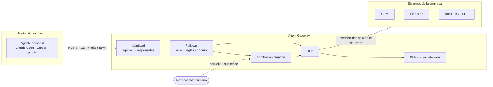

# Agent Gateway

**BYOA responsable: invita a los agentes de IA de tu equipo a trabajar, bajo tus reglas.**

Tus empleados ya usan agentes de IA: Claude Code, Cursor, agentes autohospedados en su Mac. Prohibirlos no los elimina, los vuelve invisibles. Agent Gateway hace lo contrario: los invita a trabajar con los sistemas de la empresa, gobernados, monitoreados y con **una persona responsable por cada agente**.

> **BYOA responsable** (Bring Your Own Agent): el empleado trae su agente; la empresa pone las reglas; un humano responde por él.

## Cómo funciona

El agente del empleado nunca recibe credenciales de la empresa. Solo tiene un token que sirve en el gateway, y el gateway es la única puerta hacia los sistemas internos.



En cada llamada:

1. **Identidad**: el token identifica al agente y a su responsable. Si el agente está suspendido, el responsable fue desvinculado o venció la recertificación, el acceso se corta en el acto.
2. **Catálogo a la medida**: el agente solo ve las herramientas que puede usar.
3. **Política**: conectores autorizados → techo de clasificación de datos → reglas de la empresa → nivel de confianza.
4. **Humano en el circuito**: lo consecuente (pagos, correos externos, escrituras en período de prueba) espera la aprobación del responsable, su jefatura o seguridad.
5. **DLP**: la respuesta se redacta según la autorización del agente antes de llegar al modelo del empleado.
6. **Bitácora**: todo queda registrado, atribuido a agente y responsable, en una cadena de hashes verificable.

## Principios

| Principio | En la práctica |
|---|---|
| Ningún agente sin responsable | El empleado inscribe su agente y acepta el acuerdo de uso. Responde por él. |
| El gateway es la única puerta | Las credenciales de los sistemas viven solo en el gateway. |
| Gobernamos las manos, no el cerebro | No importa qué modelo o runtime use el empleado: se controla lo que el agente puede tocar. |
| Mínimo privilegio y confianza progresiva | Permiso efectivo = conectores autorizados ∩ clasificación ∩ reglas ∩ nivel. Se parte como Observador. |
| Humano en el circuito para lo irreversible | Aprobaciones de un solo uso, ligadas a los argumentos exactos, con segregación de funciones. |
| Todo es atribuible | Bitácora encadenada por hash, sin datos personales en claro. |
| Botón rojo | Suspensión inmediata, cortacircuitos automático y baja ligada al ciclo de vida del empleado. |
| Transparencia con el equipo | Se registra lo que el agente hace en sistemas de la empresa, no el equipo ni la vida personal del empleado. |

## Qué incluye esta versión

- **Gateway MCP** (Streamable HTTP): agrega los conectores de la empresa en un único servidor MCP por agente, con instrucciones de operación personalizadas.
- **API REST equivalente** para runtimes que no hablan MCP.
- **Inscripción de agentes** con ficha (propósito, runtime, proveedor de modelo, dispositivo) y aceptación del acuerdo de uso responsable.
- **Aprobación de agentes**: nadie aprueba su propio agente; el nivel 3 solo lo aprueba seguridad; solo el responsable recibe el token.
- **Niveles de confianza** (Observador, Asistente, Colaborador, Autónomo) con comportamiento por defecto y límites de uso.
- **Techo de clasificación por proveedor de modelo**: un agente con suscripción personal no ve datos confidenciales.
- **Políticas como código** (YAML versionado en git): por conector, herramienta, tipo de acceso, nivel, área, horario y argumentos.
- **Aprobaciones humanas** con segregación de funciones (responsable, jefatura, seguridad) y espera opcional para no interrumpir al agente.
- **DLP** con detectores de secretos, tarjetas (Luhn), RUT (dígito verificador), email y teléfono.
- **Bitácora encadenada** con verificación de integridad y exportación JSON por línea para un SIEM.
- **Ciclo de vida**: tokens que vencen y rotan, recertificación periódica, cortacircuitos, desvinculación que suspende agentes y revoca tokens.
- **Consola web** en español para monitorear, aprobar, suspender e inscribir agentes.

## Inicio rápido

Requiere Node.js 22.13 o superior.

```bash
npm install
npm run demo
```

La demo levanta el gateway con dos conectores de ejemplo (CRM y Finanzas), crea un equipo ficticio, inscribe el agente de Ignacio, lo aprueba su jefatura (Camila) y simula su primera sesión:

```text
→ Lectura: el RUT llega redactado (requiere autorización restringida)
  "rut": "[REDACTADO:rut]"
→ Acción prohibida por política
  Acción bloqueada por la política de Empresa Demo SpA: Ningún agente elimina fichas de clientes...
→ Pago alto: lo aprueba la jefatura
  Acción en espera de aprobación humana (solicitud apr_…). Motivo: Pagos sobre $500.000 los aprueba la jefatura...
```

Abre `http://127.0.0.1:8080` y entra con el token de Camila que imprime la demo para aprobar el pago, aprobar la solicitud de otro empleado o suspender el agente.

### Conectar el agente de un empleado

El responsable emite el token desde la consola (o `POST /api/agents/:id/tokens`) y lo configura en su agente.

Claude Code:

```bash
claude mcp add --transport http empresa https://agentes.miempresa.cl/mcp \
  --header "Authorization: Bearer agw_…"
```

Archivo `.mcp.json` (Claude Code; otros clientes MCP usan una configuración equivalente con URL y encabezado):

```json
{
  "mcpServers": {
    "empresa": {
      "type": "http",
      "url": "https://agentes.miempresa.cl/mcp",
      "headers": { "Authorization": "Bearer agw_…" }
    }
  }
}
```

Agentes sin MCP:

```bash
curl -H "Authorization: Bearer agw_…" https://agentes.miempresa.cl/v1/tools
curl -X POST https://agentes.miempresa.cl/v1/tools/crm_buscar_clientes/call \
  -H "Authorization: Bearer agw_…" -H "Content-Type: application/json" \
  -d '{"arguments": {"texto": "andes"}}'
```

Respuestas REST: `200` ejecutada, `202` en espera de aprobación, `403` bloqueada, `502` error del conector.

### En tu entorno

```bash
export AGW_ADMIN_TOKEN="$(openssl rand -base64 32)"
AGW_CONFIG=config/gateway.yaml npm run dev        # desarrollo

npm run build
NODE_ENV=production npm start                     # producción (exige AGW_ADMIN_TOKEN)
```

Alta de personas (en producción vendrán del proveedor de identidad):

```bash
curl -X POST localhost:8080/api/people -H "Authorization: Bearer $AGW_ADMIN_TOKEN" \
  -H "Content-Type: application/json" \
  -d '{"name": "Camila Rojas", "email": "camila@miempresa.cl", "department": "comercial"}'

curl -X POST localhost:8080/api/people/<id>/tokens -H "Authorization: Bearer $AGW_ADMIN_TOKEN"
```

## Políticas

Todo vive en [`config/gateway.yaml`](config/gateway.yaml). Los secretos de los conectores se referencian como `${VARIABLE}` y se leen del entorno. Una clave mal escrita es un error al iniciar, no un permiso silencioso.

```yaml
rules:
  - id: pagos-altos-con-jefatura
    description: Pagos sobre $500.000 los aprueba la jefatura del responsable (cuatro ojos).
    when:
      connectors: [finanzas]
      tools: [emitir_pago]
      args:
        - { path: monto, op: gt, value: 500000 }
    effect: require_approval
    approver: manager

  - id: finanzas-solo-areas-autorizadas
    when: { connectors: [finanzas] }
    unless: { departments: [finanzas, comercial] }
    effect: deny
```

Precedencia: límites duros (conector autorizado y clasificación) → `deny` → `require_approval` → `allow` → comportamiento por defecto del nivel.

| Condición (`when` / `unless`) | Ejemplo | Significado |
|---|---|---|
| `connectors` | `[crm]` | Conector de la herramienta |
| `tools` | `["eliminar_*"]` | Nombre de la herramienta (admite `*` y `?`) |
| `access` | `[write]` | `read`, `write` o `destructive`, según las anotaciones MCP. Sin anotaciones se asume `destructive` |
| `tiers` | `[0, 1]` | Nivel del agente |
| `departments` | `[finanzas]` | Área del responsable |
| `agents` | `[agt_…]` | Agentes específicos |
| `outsideBusinessHours` | `true` | Fuera de `organization.businessHours` |
| `args` | `{ path: para, op: notMatches, value: "@miempresa\\.cl$" }` | `eq`, `neq`, `gt`, `gte`, `lt`, `lte`, `in`, `notIn`, `matches`, `notMatches`, `exists`. Si el valor es una lista, basta un elemento |

Niveles incluidos (configurables):

| Nivel | Lectura | Escritura | Destructiva | Datos hasta | Aprueba |
|---|---|---|---|---|---|
| 0 · Observador | sí | no | no | internos | jefatura |
| 1 · Asistente | sí | con aprobación | no | confidenciales | jefatura |
| 2 · Colaborador | sí | sí | con aprobación | confidenciales | jefatura |
| 3 · Autónomo | sí | sí | con aprobación | restringidos | seguridad |

La autorización final del agente es el mínimo entre su nivel y el techo de su proveedor de modelo (`modelProviders`).

## API

Agentes (token `agw_…`):

| Método | Ruta | Uso |
|---|---|---|
| POST | `/mcp` | Servidor MCP (Streamable HTTP, sin sesión) |
| GET | `/v1/tools` | Herramientas visibles para el agente |
| POST | `/v1/tools/:nombre/call` | Ejecuta una herramienta con gobierno |

Consola (token `agp_…` de una persona o token de administración):

| Método | Ruta | Quién |
|---|---|---|
| GET | `/api/me`, `/api/meta`, `/api/overview` | Cualquiera (cada uno ve su alcance) |
| GET/POST/PATCH | `/api/people`, `/api/people/:id`, `/api/people/:id/tokens` | Administración |
| GET/POST | `/api/agents`, `/api/agents/:id` | El empleado inscribe su propio agente |
| POST | `/api/agents/:id/approve` · `reject` · `reactivate` | Jefatura del responsable o seguridad |
| POST | `/api/agents/:id/tokens` · `recertify` | Solo el responsable |
| POST | `/api/agents/:id/suspend` | Responsable, jefatura o seguridad |
| GET/POST | `/api/approvals`, `/api/approvals/:id/decide` | Según el aprobador de cada solicitud |
| GET | `/api/audit`, `/api/audit/verify` | Alcance propio · verificación solo seguridad |

## Qué cubre y qué no

- **Cubre** lo que el agente hace con los sistemas de la empresa a través del gateway.
- **No cubre** lo que el agente haga por fuera (por ejemplo, controlando un navegador con la sesión del empleado). Para eso: nunca entregar credenciales corporativas a agentes, restringir aplicaciones OAuth de terceros en Google Workspace o Microsoft 365 y, en equipos administrados, forzar por MDM la configuración MCP de los agentes.
- **Inyección de prompts**: el gateway no impide que un agente sea manipulado, pero acota el daño con mínimo privilegio, aprobación humana para lo consecuente, DLP y cortacircuitos.
- **Bitácora**: evidencia de manipulación, no prueba absoluta; quien controle la base podría recalcular la cadena. Anclar el último hash fuera del sistema está en la hoja de ruta.
- **Tokens portadores**: si se filtran, sirven hasta que se revocan o vencen.
- **Una instancia**: SQLite (módulo nativo de Node). Para alta disponibilidad, Postgres.

## Hoja de ruta

1. SSO (OIDC) para la consola y aprovisionamiento SCIM desde el proveedor de identidad.
2. Autorización OAuth 2.1 de MCP: el empleado autoriza a su agente con su SSO, sin copiar tokens; tokens ligados al dispositivo (DPoP).
3. Aprobaciones desde Slack, Teams o email en un clic.
4. Postgres (por ejemplo, Supabase) y varias instancias.
5. OpenTelemetry, envío a SIEM y anclaje externo de la bitácora.
6. Detección de anomalías por agente: volumen, horario, herramientas nuevas.
7. Gateway de modelos opcional para datos restringidos con un proveedor corporativo.

Detalle de diseño en [docs/arquitectura.md](docs/arquitectura.md) y plantilla de política para tu equipo en [docs/politica-byoa.md](docs/politica-byoa.md).

## Estructura

```text
config/gateway.yaml      Conectores, niveles, DLP y reglas (políticas como código)
src/
  app.ts                 Servidor HTTP: /mcp, /v1, /api y consola
  governance.ts          Pipeline: límites → política → aprobación → conector → DLP → auditoría
  policy.ts              Motor de políticas
  dlp.ts                 Detectores y redacción
  audit.ts               Bitácora encadenada por hash
  connectors.ts          Clientes MCP hacia los sistemas de la empresa
  mcp.ts                 Servidor MCP por agente
  api.ts                 API de la consola
  auth.ts · tokens.ts    Identidad de agentes y personas
  store.ts               Persistencia (SQLite)
public/                  Consola web (sin build)
examples/                Conectores de demostración (CRM y Finanzas)
scripts/demo.ts          Demo de punta a punta
test/                    Pruebas unitarias y de punta a punta con un cliente MCP real
```

## Desarrollo

```bash
npm run typecheck
npm test
```
