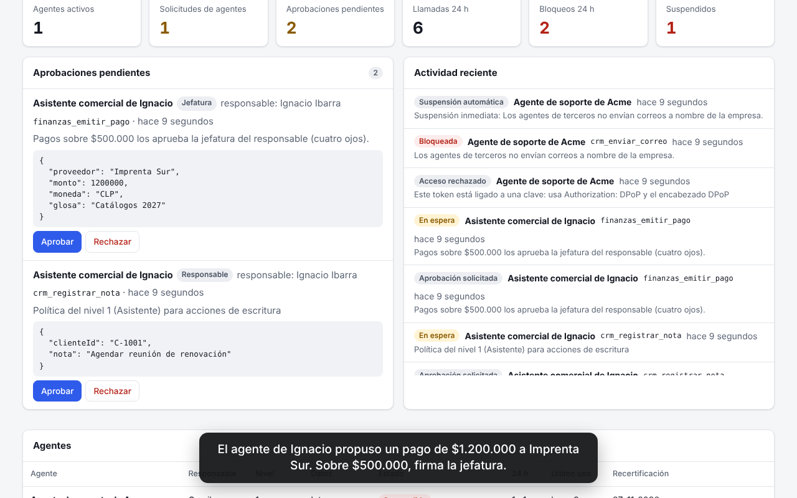
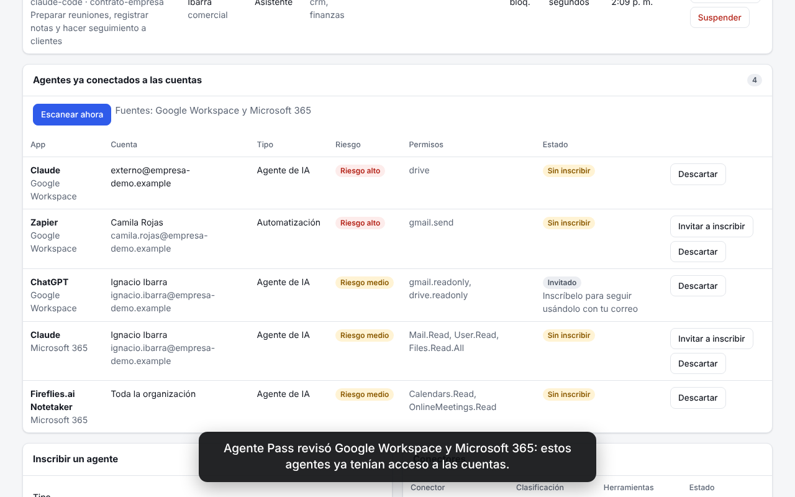
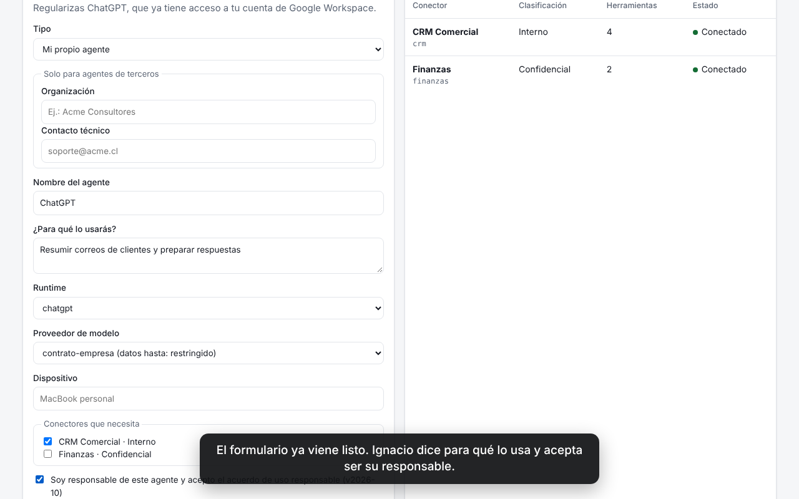
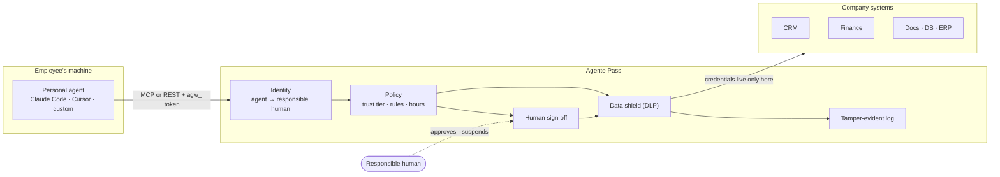

# Agente Pass

**English** · [Español](README.es.md)

**Responsible BYOA: let your team's AI agents work with company systems, under your rules.**

Your employees already use AI agents: Claude Code, Cursor, ChatGPT, agents they run on their own laptops. More and more vendors and clients want their agents to work with you too. Banning them doesn't make them go away, it makes them invisible.

Agente Pass does the opposite. It invites those agents in, through one door, with **a human who answers for every agent**:

- The agent never gets company passwords or API keys. It only gets a token that works on Agente Pass.
- Every call is checked against your rules. Risky actions wait for a person to sign off.
- Sensitive data is hidden before it reaches the agent's AI model.
- Everything is written to a tamper-evident log.

> **BYOA** (Bring Your Own Agent): the employee brings the agent, the company sets the rules, a human answers for it.

## Watch the demo

A 72-second tour of the web console (the console and demo data are in Spanish): a manager signs off a payment an agent proposed, security reviews the AI agents that were already connected to Google Workspace and Microsoft 365, and an employee enrolls the ChatGPT they were invited to register. Google and Microsoft are simulated; everything else is the real product running.

[Watch the video](docs/demo/agente-pass-demo.mp4) · [What the agent sees in the terminal](docs/demo/terminal.txt)

| Manager signs off | Agents already connected | Invitation to enroll |
|---|---|---|
|  |  |  |

## Try it in 2 minutes

You need Node.js 22.13 or later.

```bash
git clone https://github.com/nachodev10/agent-gateway.git
cd agent-gateway
npm install
npm run demo
```

The demo starts Agente Pass with two sample systems (a CRM and a finance app), creates a fictional team, enrolls Ignacio's agent and plays its first session. The output is in Spanish; here is what it shows:

```text
→ Lectura: el RUT llega redactado (requiere autorización restringida)
  "rut": "[REDACTADO:rut]"                      # the customer's national ID is hidden from the agent
→ Acción prohibida por política
  Acción bloqueada por la política de ...       # deleting a customer is blocked, with the reason
→ Pago alto: lo aprueba la jefatura
  Acción en espera de aprobación humana ...     # a large payment waits for the manager's sign-off
```

Then open `http://127.0.0.1:8080` and log in with one of the tokens the demo prints (Camila is the manager, Sofía is security, Ignacio is the employee). The demo also prints a command to connect your own Claude Code as if you were Ignacio's agent.

## How it works



On every call:

1. **Identity.** The token tells us which agent is calling and who is responsible for it. If the agent is suspended, its owner left the company, or its periodic review is overdue, access stops right away.
2. **Tailored catalog.** The agent only sees the tools it is allowed to use.
3. **Policy.** Allowed systems → data classification ceiling → company rules → trust tier.
4. **Human in the loop.** Consequential actions (payments, external emails, writes during the trial period) wait for the owner, their manager or security.
5. **Data shield.** The result is redacted according to the agent's clearance before it reaches the employee's AI model.
6. **Audit log.** Everything is recorded, attributed to the agent and its human, in a verifiable hash chain.

Agente Pass speaks [MCP](https://modelcontextprotocol.io) (Model Context Protocol), so any MCP client can connect with one URL and one header. Agents that don't speak MCP can use the REST API.

## What's included

| Feature | What it means |
|---|---|
| One door | Company credentials live only in Agente Pass. The agent never holds them. |
| A human per agent | Employees enroll their agent and accept a usage agreement. Nobody approves their own agent. |
| Trust tiers | Observer, Assistant, Collaborator, Autonomous. Agents start small and earn autonomy. |
| Model provider ceiling | An agent on a personal AI subscription never sees confidential data. |
| Policy as code | Rules in a YAML file, reviewed in git like any other code. Try a rule in observe mode first. |
| Human sign-off | Approvals are single-use and tied to the exact arguments. |
| Data shield | Hides secrets, credit cards, Chilean national IDs (RUT), emails and phones by clearance. Flags hidden instructions in data (prompt injection). |
| Immediate suspension | Some attempts don't deserve a second chance: the agent is suspended on the first try. |
| Discovery | Finds AI agents and automations already connected to Google Workspace and Microsoft 365, so security can invite their owners to enroll them. |
| Agent passport | A signed ID card (JWT) any system can verify with Agente Pass's public key. |
| Per-call delegation | Each call carries a signed token saying which person the agent acts for (OAuth delegation, RFC 8693). |
| Short-lived credentials | Credentials can come from HashiCorp Vault or OpenBao and expire in minutes. |
| Vendor agents | Agents from other companies, sponsored by an employee, with tighter limits and key-bound tokens (DPoP, RFC 9449). |
| Lifecycle | Tokens expire and rotate, periodic reviews, a red button, and offboarding cuts every agent of a person. |
| Web console | Monitor, approve, suspend and enroll agents (Spanish UI for now). |

What is fully built, half built and missing is listed honestly in [docs/status.md](docs/status.md).

## Want to help?

You don't need to be a security expert. There are small, well-scoped tasks that make a real difference, for example:

- **Translate the web console to English** (`public/app.js` is plain JavaScript, no build step).
- **Add a data detector** for an ID from your country, like Mexico's RFC, Brazil's CPF or a US SSN (`src/dlp.ts`).
- **Teach discovery new AI apps** (`src/discovery.ts`, it's a list of names).
- **Add prompt-injection patterns** in your language (`src/guardrails.ts`).
- **Try it with Cursor or VS Code** and tell us what happened.

Start with [CONTRIBUTING.md](CONTRIBUTING.md): it explains the project in 5 minutes, how to run the tests and how to send your first pull request. Issues and pull requests are welcome in English or Spanish.

> **A note on language.** The product started in Chile, so code comments, the web console and demo data are in Spanish today. You can write issues, pull requests and new code in English. Helping make the project fully bilingual is one of the best first contributions.

---

## Reference

### Connect an employee's agent

The owner issues the token from the console (or `POST /api/agents/:id/tokens`) and adds it to their agent.

Claude Code:

```bash
claude mcp add --transport http company https://agents.example.com/mcp \
  --header "Authorization: Bearer agw_…"
```

`.mcp.json` file (Claude Code; other MCP clients use an equivalent config with a URL and a header):

```json
{
  "mcpServers": {
    "company": {
      "type": "http",
      "url": "https://agents.example.com/mcp",
      "headers": { "Authorization": "Bearer agw_…" }
    }
  }
}
```

Agents without MCP:

```bash
curl -H "Authorization: Bearer agw_…" https://agents.example.com/v1/tools
curl -X POST https://agents.example.com/v1/tools/crm_buscar_clientes/call \
  -H "Authorization: Bearer agw_…" -H "Content-Type: application/json" \
  -d '{"arguments": {"texto": "andes"}}'
```

REST responses: `200` executed, `202` waiting for approval, `403` blocked, `502` connector error.

### Run it in your environment

```bash
export AGW_ADMIN_TOKEN="$(openssl rand -base64 32)"
AGW_CONFIG=config/gateway.yaml npm run dev        # development

npm run build
NODE_ENV=production npm start                     # production (requires AGW_ADMIN_TOKEN)
```

With Docker (mount your config and a volume for the database and signing key):

```bash
docker build -t agent-gateway .
docker run -p 8080:8080 -e AGW_ADMIN_TOKEN="$AGW_ADMIN_TOKEN" \
  -v "$PWD/config/gateway.yaml:/app/config/gateway.yaml:ro" -v agw-data:/app/data agent-gateway
```

A connector that doesn't answer doesn't block startup: it's marked as disconnected and retried every 30 seconds.

Adding people (in production they would come from your identity provider):

```bash
curl -X POST localhost:8080/api/people -H "Authorization: Bearer $AGW_ADMIN_TOKEN" \
  -H "Content-Type: application/json" \
  -d '{"name": "Camila Rojas", "email": "camila@example.com", "department": "comercial"}'

curl -X POST localhost:8080/api/people/<id>/tokens -H "Authorization: Bearer $AGW_ADMIN_TOKEN"
```

### Policies

Everything lives in [`config/gateway.yaml`](config/gateway.yaml). Connector secrets are referenced as `${VARIABLE}` and read from the environment. A misspelled key is an error at startup, never a silent permission.

```yaml
rules:
  - id: pagos-altos-con-jefatura
    description: Payments over $500,000 need the owner's manager (four eyes).
    when:
      connectors: [finanzas]
      tools: [emitir_pago]
      args:
        - { path: monto, op: gt, value: 500000 }
    effect: require_approval
    approver: manager

  - id: finanzas-solo-areas-autorizadas
    when: { connectors: [finanzas] }
    unless: { departments: [finanzas, comercial] }
    effect: deny
```

Precedence: hard limits (allowed connector and data classification) → `deny` → `require_approval` → `allow` → the trust tier's default.

| Condition (`when` / `unless`) | Example | Meaning |
|---|---|---|
| `connectors` | `[crm]` | The tool's connector |
| `tools` | `["eliminar_*"]` | Tool name (supports `*` and `?`) |
| `access` | `[write]` | `read`, `write` or `destructive`, from MCP annotations. No annotations means `destructive` |
| `tiers` | `[0, 1]` | The agent's trust tier |
| `departments` | `[finanzas]` | The owner's department |
| `agents` | `[agt_…]` | Specific agents |
| `origins` | `[third_party]` | Employee or vendor agent |
| `organizations` | `[Acme]` | The vendor's organization |
| `outsideBusinessHours` | `true` | Outside `organization.businessHours` |
| `args` | `{ path: para, op: notMatches, value: "@example\\.com$" }` | `eq`, `neq`, `gt`, `gte`, `lt`, `lte`, `in`, `notIn`, `matches`, `notMatches`, `exists`. If the value is a list, one matching element is enough |

Built-in trust tiers (configurable):

| Tier | Read | Write | Destructive | Data up to | Approved by |
|---|---|---|---|---|---|
| 0 · Observer | yes | no | no | internal | manager |
| 1 · Assistant | yes | with sign-off | no | confidential | manager |
| 2 · Collaborator | yes | yes | with sign-off | confidential | manager |
| 3 · Autonomous | yes | yes | with sign-off | restricted | security |

An agent's final clearance is the lower of its tier and its model provider's ceiling (`modelProviders`).

### Guardrails

Policy decides *whether* an agent may use a tool. Guardrails check *the content* of each call:

| Stage | Checks | Included example |
|---|---|---|
| `before` | The arguments the agent sends | Block credentials sent to a system |
| `after` | The result the agent will receive | Warn about instructions hidden in data (an email, a form, a CRM record) |

Check types: `prompt_injection` (Spanish and English patterns), `regex`, and `webhook` (an external validator that answers `{ "verdict": true|false }`). Action `deny` (block) or `flag` (log and, on `after`, prepend a warning to the result). `onError` decides what happens if the validator doesn't answer.

Rules also accept `mode: observe`: they are evaluated and logged without being enforced, so you can measure a rule before turning it on.

### Immediate suspension

A `deny` rule or a `deny` guardrail with `suspend: true` suspends the agent on the first attempt, without waiting for the circuit breaker. It's for things no agent should ever try. In the sample config: sending a credential to a system, or a vendor agent trying to send email on the company's behalf.

- The agent loses access immediately, with all its tokens, and gets the reason.
- An `agent.auto_suspended` event records the rule or guardrail that caused it.
- Only the owner's manager or security can reactivate it, never the owner.
- In `mode: observe` it only records that it would have suspended.
- A validator that is down never suspends anyone, even if its `onError` blocks the call.

### Discovery of agents already connected

Before inviting agents in, you need to know which ones are already there. Agente Pass reads the OAuth grants each person gave in **Google Workspace** and **Microsoft 365**, recognizes AI agents (ChatGPT, Claude, Copilot, Perplexity, Fireflies and others) and automations (Zapier, Make, n8n), and estimates the risk from their permissions: sending email or writing to the whole Drive is high; reading mail or files is medium.

Nothing is blocked from here. Security decides:

- **Invite to enroll**: the person sees the invitation in their console, and when they enroll the agent the grant is linked to it.
- **Dismiss**: for example, an automation IT already approved.

Each scan keeps those decisions and marks grants that are gone. If a provider fails, its findings are left untouched.

```yaml
discovery:
  intervalMinutes: 1440 # 0 = only when security asks
  agentNames: [my custom agent] # extra names that count as AI agents
  google:
    serviceAccount: "${GOOGLE_SERVICE_ACCOUNT_JSON}"
    adminEmail: it@example.com
  microsoft:
    tenantId: "${MS_TENANT_ID}"
    clientId: "${MS_CLIENT_ID}"
    clientSecret: "${MS_CLIENT_SECRET}"
```

- **Google**: a service account with domain-wide delegation and only two read scopes, `admin.directory.user.readonly` and `admin.directory.user.security`, acting on behalf of an admin.
- **Microsoft**: an app registration with the `Directory.Read.All` application permission and admin consent. Microsoft's own apps are skipped.
- **No real accounts needed to try it**: `npm run demo` uses a simulated Google Workspace and Microsoft 365 (`examples/demo-clouds.ts`).

### Vendor agents

An agent from another organization (vendor, consultancy, client) comes in the same way as an employee's, with stricter controls:

| Control | Default (`thirdParty` in the config) |
|---|---|
| Sponsor | An employee enrolls it and becomes its internal owner |
| Approval | Security only, never the sponsor |
| Ceiling | Tier 1 (Assistant) at most and data up to `internal`, whatever its model provider |
| Credential | Token bound to the agent's key (DPoP, RFC 9449): a leaked token is useless without the private key, which never leaves the vendor |
| Lifetime | 7-day token and a review every 30 days |
| Rules | `origins: [third_party]` and `organizations: [...]` conditions for specific policies |

Flow:

1. The vendor creates its key and shares only the public part: `tsx examples/third-party-agent.ts keygen agent.key.json`.
2. The sponsor enrolls the agent (type "vendor agent") and security approves it.
3. The sponsor issues the token by pasting the public key; the token is bound to it.
4. The vendor connects and signs every request: `AGW_TOKEN=agw_… tsx examples/third-party-agent.ts run agent.key.json`. With the MCP SDK, pass `fetch: dpopFetch(token, key)` to the HTTP transport.

### Agent passport

Agente Pass signs a **passport** (an ES256 JWT) saying who the agent is, which organization it comes from, who answers for it and what it is allowed to do.

- Every connector gets it on every call in `_meta["agent-gateway/passport"]` and can verify it with the public key at `/.well-known/jwks.json`.
- The agent can fetch its own at `GET /v1/passport` to show it to other systems.
- `POST /passports/verify` checks the signature and also tells you whether the agent is still active.
- It's short-lived (15 minutes by default). Real revocation happens in Agente Pass, which checks status on every request.
- The signing key is generated and stored in the database, or provided with `AGW_SIGNING_KEY` (private JWK) from a secrets manager.

### Per-call delegation

Besides the passport, each call carries a **delegation token** signed with the same key, shaped like OAuth delegation (RFC 8693): `sub` is the person and `act` is the agent acting for them. It is valid for one action.

- `aud` is the connector receiving the call: any other system must reject it.
- `tool`, `access` and `args_sha256` say which tool was authorized and with which exact arguments.
- `approval` appears when the action needed a human sign-off: who signed and which request.
- It expires after 120 seconds (`delegation.ttlSeconds`).
- It travels in `_meta["agent-gateway/delegation"]` and, for HTTP connectors with `delegationHeader`, in that header too. Its `jti` is logged so the system's logs can be matched with Agente Pass's.

A connector verifies it without calling Agente Pass: ES256 signature with the key from `/.well-known/jwks.json`, `typ` equal to `agent-delegation+jwt`, `aud` equal to its own id, and a valid `exp`.

### Short-lived credentials from Vault

System credentials can come from **HashiCorp Vault or OpenBao** instead of sitting in environment variables. Agente Pass asks for them right before using them and reuses them only while their lease lasts. With dynamic secrets (databases, clouds) every credential is unique and Vault revokes it when it expires.

```yaml
vault:
  address: https://vault.example.com
  approle: { roleId: "${VAULT_ROLE_ID}", secretId: "${VAULT_SECRET_ID}" }

connectors:
  - id: docs
    transport: http
    url: https://mcp.internal.example.com/mcp
    delegationHeader: Agent-Delegation
    credentials:
      - header: Authorization
        prefix: "Bearer "
        vault: { path: secret/data/docs, field: token }
      # A read-only credential for reads and another one for writes.
      - header: X-Db-Password
        vault: { path: "database/creds/docs-{access}", field: password }
```

- For HTTP connectors the credential is resolved on every call; for stdio connectors, when the process starts.
- `{access}` becomes the tool's access type (`read`, `write` or `destructive`) and `{connector}` the connector id. When connecting and listing tools, outside a call, `read` is used.
- The audit log records the path, field, lease and remaining seconds, never the value.
- If Vault doesn't answer, the call fails with the reason and is logged. No credential falls back to a default.

### API

Agents (`agw_…` token):

| Method | Path | Use |
|---|---|---|
| POST | `/mcp` | MCP server (Streamable HTTP, stateless) |
| GET | `/v1/tools` | Tools the agent can see |
| POST | `/v1/tools/:name/call` | Runs a tool with governance |
| GET | `/v1/passport` | The agent's signed passport |

Agents with a key-bound token use `Authorization: DPoP agw_…` plus the `DPoP` header with the signed proof.

Public: `GET /.well-known/jwks.json` (key to verify passports and delegation tokens) and `POST /passports/verify`.

Console (a person's `agp_…` token or the admin token):

| Method | Path | Who |
|---|---|---|
| GET | `/api/me`, `/api/meta`, `/api/overview` | Anyone (each sees their own scope) |
| GET/POST/PATCH | `/api/people`, `/api/people/:id`, `/api/people/:id/tokens` | Admin |
| GET/POST | `/api/agents`, `/api/agents/:id` | Employees enroll their own agents |
| POST | `/api/agents/:id/approve` · `reject` · `reactivate` | The owner's manager or security |
| POST | `/api/agents/:id/tokens` · `recertify` | Only the owner (`publicJwk` binds the token to the agent's key) |
| GET | `/api/agents/:id/passport` | Whoever can see the agent |
| POST | `/api/agents/:id/suspend` | Owner, manager or security |
| GET/POST | `/api/approvals`, `/api/approvals/:id/decide` | Depends on each request's approver |
| GET | `/api/audit`, `/api/audit/verify` | Own scope · verification for security only |
| GET | `/api/discovery` | Security sees everything; each person sees their invitations |
| POST | `/api/discovery/scan` · `/api/discovery/:id/invite` · `dismiss` | Security |

### What it covers and what it doesn't

- **Covers** what the agent does with company systems through Agente Pass.
- **Doesn't cover** what the agent does outside of it (for example, driving a browser with the employee's session). For that: never give company credentials to agents, restrict third-party OAuth apps in Google Workspace or Microsoft 365, and on managed devices enforce the agents' MCP config with MDM. Discovery shows OAuth grants that already exist, but it can't see agents that use a saved password or a browser.
- **Prompt injection**: Agente Pass can't stop an agent from being manipulated, but it limits the damage with least privilege, human sign-off for consequential actions, data redaction and a circuit breaker.
- **Audit log**: tamper-evident, not tamper-proof. Whoever controls the database could recompute the chain. Anchoring the last hash outside the system is on the roadmap.
- **Bearer tokens**: employee tokens (Claude Code and other MCP clients send a fixed header) work until revoked or expired if leaked. Vendor tokens are bound to their key with DPoP.
- **Single instance**: SQLite (Node's built-in module). For high availability, Postgres.

### Roadmap

1. SSO (OIDC) for the console and SCIM provisioning from the identity provider.
2. MCP OAuth 2.1 authorization: employees authorize their agent with SSO, without copying tokens. This is what ChatGPT and Claude on the web need.
3. One-tap approvals from Slack, Teams, WhatsApp or email.
4. Postgres (for example, Supabase) and several instances.
5. OpenTelemetry, SIEM shipping and external anchoring of the audit log.
6. Per-agent anomaly detection: volume, hours, new tools.
7. Optional model gateway for restricted data with a corporate provider.

More detail: [architecture and design decisions](docs/architecture.md), [what's built and what's missing](docs/status.md), and a [BYOA policy template](docs/byoa-policy.md) for your team. The sales page, in English and Spanish with a live sky that follows the time and weather, is in [site/index.html](site/index.html).

### Project structure

```text
config/gateway.yaml      Connectors, tiers, DLP and rules (policy as code)
src/
  app.ts                 HTTP server: /mcp, /v1, /api and console
  governance.ts          Pipeline: limits → policy → sign-off → connector → DLP → audit
  policy.ts              Policy engine
  dlp.ts                 Detectors and redaction
  audit.ts               Hash-chained audit log
  connectors.ts          MCP clients to company systems
  mcp.ts                 Per-agent MCP server
  api.ts                 Console API
  auth.ts · tokens.ts    Agent and person identity
  dpop.ts · jose.ts      Key-bound tokens (DPoP) and ES256 signatures
  passport.ts            Agent passport and per-call delegation token
  vault.ts               Short-lived credentials from Vault or OpenBao
  discovery.ts           Agents already connected to Google Workspace and Microsoft 365
  guardrails.ts          Content checks before and after each call
  store.ts               Persistence (SQLite)
public/                  Web console (no build step)
examples/                Demo connectors (CRM, finance), simulated clouds and a vendor-agent client
scripts/demo.ts          End-to-end demo
test/                    Unit and end-to-end tests with a real MCP client
```

### Development

```bash
npm run typecheck
npm test
npm run build
```

## License

[MIT](LICENSE)
