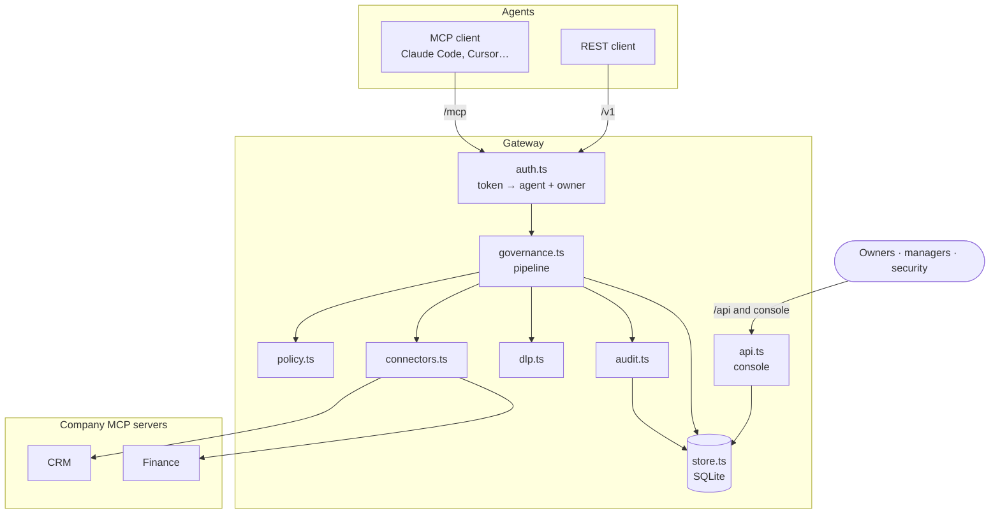
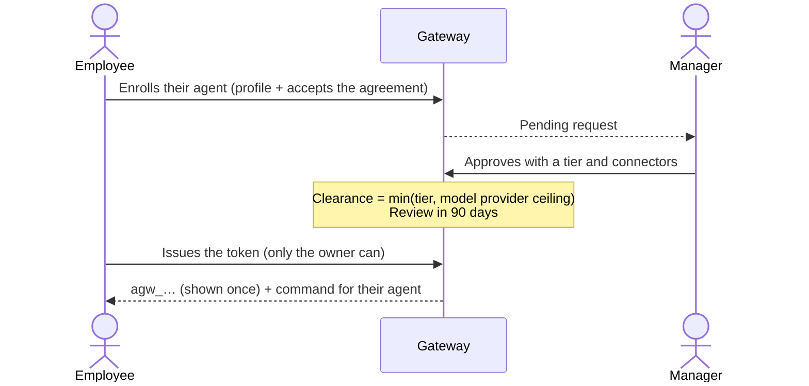
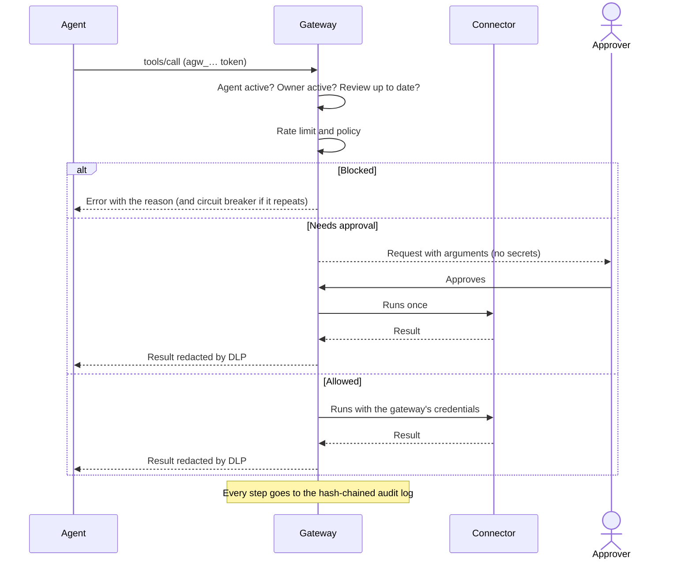

# Architecture and design decisions

**English** · [Español](arquitectura.md)

## The problem

Employees adopt AI agents faster than companies can evaluate them. When agents are banned, people keep using them with personal accounts and copy data by hand: the company loses visibility and control. BYOD solved something similar with personal phones: the device wasn't banned, the company space was separated and governed.

Agente Pass applies the same idea to agents. The company doesn't control the employee's agent; it controls **what the agent can touch** in the company, and it requires every agent to have a **responsible human**.

## Key decisions

| Decision | Rejected alternative | Why |
|---|---|---|
| One gateway as the single point of control | Installing control software on the employee's device | The device is personal: invasive, fragile and hard to justify. The gateway governs only the company's space. |
| MCP as the main protocol | Custom integrations per agent runtime | Claude Code, Cursor, VS Code and others already speak MCP. One endpoint serves them all. REST covers the rest. |
| Credentials only in the gateway | Giving API keys to each agent | A compromised agent can't leak what it doesn't have. Revoking an agent doesn't require rotating system credentials. |
| Short-lived credentials from Vault or OpenBao | Fixed keys in environment variables | A credential that lasts minutes is worth little if leaked, and reads and writes can use different credentials. |
| Per-call delegation token (RFC 8693) | Systems only see the gateway's service account | Each system knows which person the agent acts for, in which action and with whose sign-off, and can verify it without calling the gateway. |
| Opaque tokens checked on every request | Self-contained JWTs | Suspending or offboarding takes effect immediately, without revocation lists. |
| Stateless MCP (one server per request) | Long-lived sessions | Identity and permissions are re-evaluated on every call; it scales horizontally. |
| Effective permission by intersection | Cumulative permissions | The agent never exceeds what was authorized: connectors ∩ classification ∩ rules ∩ tier. |
| `deny` wins | First matching rule | A security rule can't be overridden by the order of the file. |
| No MCP annotations = destructive | Assume read-only | It's the MCP specification's default and the safe side. |
| Single-use approvals tied to the arguments' hash | Approving the tool in general | Approving "pay $1,200,000 to Imprenta Sur" doesn't authorize another payment. |
| The audit log stores redacted arguments | Storing everything in clear text | The audit log shouldn't become a store of personal data. |
| Policies in versioned YAML | Policies editable from the console | Every policy change goes through review and stays in git history. |
| Node's built-in SQLite | An external database from day one | Zero dependencies to start; persistence is isolated so it can move to Postgres. |

## Components

## Flows

### Enrollment (like hiring a collaborator)

### An agent call

If the decision arrives within `approvals.waitSeconds`, the call completes without the agent retrying. Otherwise the agent gets "pending" and retries with the same arguments once approved.

### Offboarding an employee

When the person is marked inactive (in production, through a SCIM event from the identity provider), in a single transaction: their agents are suspended, their agents' and console tokens are revoked, and the audit log records it.

## Vendor agents

The same accountability model extends to agents from other organizations: an employee **sponsors** them and becomes their internal owner. Since the company controls neither the vendor's device nor its process, controls get stricter:

- Approval by security only, a maximum tier and data ceiling of their own (`thirdParty`), more frequent reviews.
- **Token bound to the agent's key (DPoP, RFC 9449).** The vendor generates a key pair and shares only the public key; the token stores its thumbprint (RFC 7638). On every request the agent signs a proof with the method, URL, time and the token's hash. The gateway checks the signature, the thumbprint, the age and that the proof wasn't used before. A leaked token, or one passed hand to hand, is useless without the private key.

## Agent passport

The gateway issues an ES256-signed JWT describing the agent, its organization, its owner and its clearance (with `cnf.jkt` if the token is key-bound). Connectors receive it on every call and can make their own decisions or record who acted. They verify it without contacting the gateway, with the public key at `/.well-known/jwks.json`.

It's deliberately short-lived: revocation is enforced by the gateway on every request, and the passport only informs. This is the no-blockchain answer to "one key per agent": verifiable cryptographic identity, revocable instantly, with no personal data in a public registry.

## Per-call delegation

The passport says who the agent is. The delegation token says what it's doing right now and for whom. It follows OAuth's delegation shape (RFC 8693, section 4.1): `sub` is the person and `act` is the agent acting for them. It also carries the audience (`aud`, the connector), the tool, the access type, the arguments' hash and, if there was a human sign-off, the approval and who gave it. It lasts two minutes and its `jti` goes to the audit log.

With it, a system that doesn't trust the gateway as a generic service account can require the token and record the real person behind every change, as accountability laws such as Chile's Law 21.719 ask.

## Short-lived credentials

Connector credentials can come from HashiCorp Vault or OpenBao. The gateway authenticates with AppRole (or a token), reads the secret right before the call and reuses it while its lease lasts, minus a margin (`renewBeforeSeconds`). With dynamic secrets, Vault issues a unique credential per lease and revokes it when it expires. The path accepts `{access}`, so reads can use a read-only role and writes another.

For HTTP connectors, a connector-specific `fetch` adds the credentials and the delegation header to every request, using the context of the call in progress (`AsyncLocalStorage`). For stdio connectors, credentials are passed as environment variables when the process starts.

## Immediate suspension

The circuit breaker suspends an agent that piles up blocks; it's meant for probing and loops. Some attempts don't deserve a second chance, like trying to send out a credential. A `deny` rule or a `deny` guardrail with `suspend: true` suspends the agent on the first attempt. Suspension invalidates all its tokens on the next request and only the owner's manager or security can undo it. If several rules block the same call, the one that suspends wins. A guardrail that couldn't be evaluated (for example, a validator that's down) never suspends.

## Discovery

The gateway governs what goes through it, but an employee may have connected an agent straight to their mail or Drive. Discovery reads those OAuth grants in Google Workspace (Admin SDK, per-user tokens, with a read-only service account) and Microsoft 365 (Graph, delegated permissions, with `Directory.Read.All`), classifies them (AI agent, automation or other app) and estimates their risk from the permissions.

It blocks nothing: security invites to enroll or dismisses, and the person enrolls their agent from the invitation, which gets linked to the agent. It's the same responsible-BYOA idea applied to what already exists: invite instead of ban. To cut an OAuth grant, use Google's or Microsoft's admin console.

## Guardrails

Policy decides *whether* an agent may use a tool; guardrails check *what content* goes in and out. The design borrows the hook idea from Portkey's model gateway (before and after checks, a verdict, block or observe, an external validator via webhook) and applies it to tools:

- `before` checks the arguments (already without credentials) before asking for approval or touching the system.
- `after` checks the result, already redacted by DLP. The main risk is indirect injection: instructions hidden in third-party data (emails, forms, documents) that the agent might follow. With `flag`, the gateway prepends a warning to the result; with `deny`, it withholds it (the action already happened in the system, and that's recorded).

## Relationship with a model gateway

Agente Pass governs what the agent **touches** (tools and data). A model gateway like Portkey governs **which model** it thinks with (routing, retries, costs). They're complementary layers: for `restricted` data, the recommendation is to require the agent to use the corporate model behind a model gateway, instead of reimplementing that routing here.

## Data classification and model providers

Everything the gateway gives an agent ends up at the model provider the employee chose. That's why an agent's clearance has two ceilings:

- **Trust tier**: how much the agent and its owner are trusted.
- **Model provider**: where the data ends up. A personal subscription shouldn't receive confidential data; a provider with a corporate contract and no retention can.

Connectors are classified as `public`, `internal`, `confidential` or `restricted`. An agent doesn't see connectors above its clearance, and within the ones it sees, DLP reveals each data type only if the clearance reaches the configured threshold (for example, Chilean national IDs only for `restricted`).

## Threat model

| Threat | Mitigation in this version | Pending |
|---|---|---|
| Agent manipulated by prompt injection | Least privilege, human sign-off for consequential actions, operating instructions, circuit breaker | Exfiltration pattern detection |
| Data exfiltration to the model provider | Classification ceiling per provider, DLP by clearance | Corporate model gateway |
| Agent probing permissions | Hidden tools, audited blocks, automatic suspension | Real-time alerts |
| Agent token theft | Hashed at rest, expiry, rotation, immediate suspension; DPoP required for vendors | DPoP for employees' MCP clients, IP allow lists |
| A system credential leaks | Short-lived credentials from Vault, different for reads and writes; they never reach the agent | Revoke active leases when an agent is suspended |
| Vendor passes its token to another agent | Token bound to the vendor's key; passport with `cnf.jkt` | Runtime attestation |
| Owner leaves the company | Offboarding suspends and revokes | Automatic SCIM |
| The owner abuses their own agent | Nobody approves their own agent; payments need the manager; audit log | Periodic review by security |
| Audit log tampering | Verifiable hash chain | External anchoring of the last hash |
| Agents outside the gateway (shadow AI) | No company credential outside the gateway; usage policy; discovery of OAuth grants in Google Workspace and Microsoft 365 with invitation to enroll | Agents using saved passwords or a browser; network logs |
| Manipulated agent attempting something serious | Rules and guardrails with `suspend: true`: suspension on the first attempt | Real-time alerts to security |

## Reference frameworks

- **OWASP Top 10 for LLM applications**: especially prompt injection and excessive agency, which the gateway limits with least privilege and human sign-off.
- **NIST AI RMF** (govern, map, measure, manage) and **ISO/IEC 42001**: inventory of agents, owners, controls and evidence.
- **Chile, Law 21.719 on personal data protection** (in force from December 2026): demonstrated accountability, security measures and traceability of processing.
- **Chile, Labor Code**: control measures must be in the internal regulations and be general and impersonal (art. 154). Review the policy with your legal and labor advisors.

## Suggested deployment

- The gateway behind a TLS proxy, reachable by agents over the internet or a VPN; connectors on the internal network, not directly exposed.
- `AGW_ADMIN_TOKEN` and connector secrets in a secrets manager.
- `audit.stdout: true` to ship the audit log to your SIEM.
- Database backups and periodic chain verification (`GET /api/audit/verify`).
