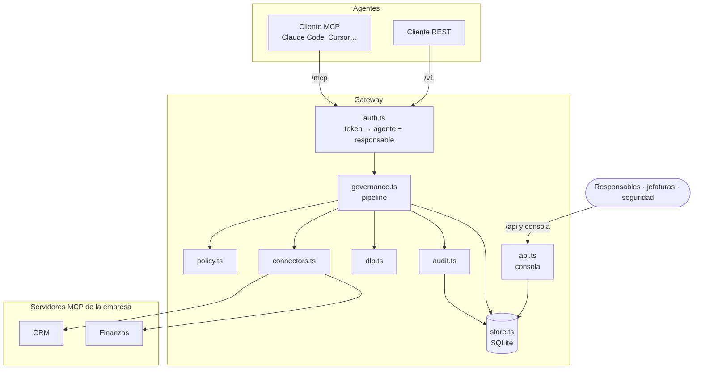
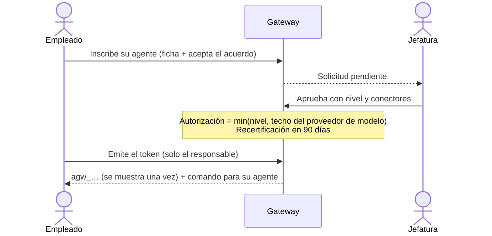
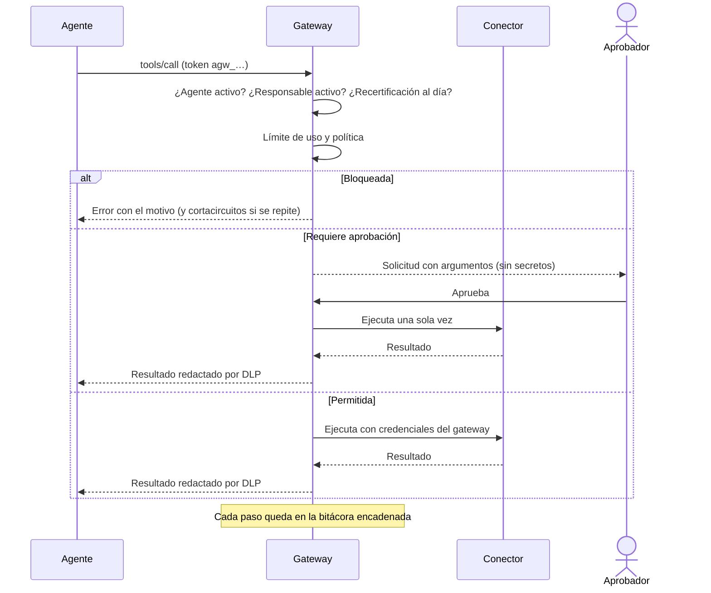

# Arquitectura y decisiones de diseño

## El problema

Los empleados adoptan agentes de IA más rápido de lo que la empresa los puede evaluar. Cuando se prohíben, siguen usándose con cuentas personales y copiando datos a mano: la empresa pierde visibilidad y control. El modelo BYOD resolvió algo parecido con los teléfonos personales: no se prohibió el dispositivo, se separó lo corporativo y se gobernó ese espacio.

Agent Gateway aplica la misma idea a los agentes: la empresa no controla el agente del empleado, controla **lo que el agente puede tocar** de la empresa, y exige que cada agente tenga un **responsable humano**.

## Decisiones clave

| Decisión | Alternativa descartada | Motivo |
|---|---|---|
| Un gateway como punto único de control | Instalar software de control en el equipo del empleado | El equipo es personal: invasivo, frágil y difícil de justificar. El gateway gobierna solo el espacio de la empresa. |
| MCP como protocolo principal | Integraciones a medida por runtime | Claude Code, Cursor, VS Code y otros ya hablan MCP. Un endpoint sirve a todos. REST cubre el resto. |
| Credenciales solo en el gateway | Entregar llaves de API a cada agente | Un agente comprometido no puede filtrar lo que no tiene. Revocar al agente no exige rotar credenciales de sistemas. |
| Tokens opacos verificados en cada request | JWT autocontenidos | Suspender o desvincular tiene efecto inmediato, sin listas de revocación. |
| MCP sin sesión (un servidor por request) | Sesiones de larga duración | La identidad y los permisos se reevalúan en cada llamada; escala horizontalmente. |
| Permiso efectivo por intersección | Permisos acumulativos | El agente nunca supera lo autorizado: conectores ∩ clasificación ∩ reglas ∩ nivel. |
| `deny` prevalece | Primera regla que coincide | Una regla de seguridad no puede quedar anulada por el orden del archivo. |
| Sin anotaciones MCP = destructiva | Asumir lectura | Es el valor por defecto de la especificación MCP y el lado seguro. |
| Aprobaciones de un solo uso, ligadas al hash de los argumentos | Aprobar la herramienta en general | Aprobar "pagar $1.200.000 a Imprenta Sur" no autoriza otro pago. |
| La bitácora guarda argumentos redactados | Guardar todo en claro | La auditoría no debe convertirse en un depósito de datos personales. |
| Políticas en YAML versionado | Políticas editables desde la consola | Cada cambio de política pasa por revisión y queda en el historial de git. |
| SQLite nativo de Node | Base externa desde el día uno | Cero dependencias para partir; la capa de persistencia está aislada para migrar a Postgres. |

## Componentes

## Flujos

### Inscripción (como contratar a un colaborador)

### Una llamada del agente

Si la decisión llega dentro de `approvals.waitSeconds`, la llamada se completa sin que el agente reintente. Si no, el agente recibe "en espera" y reintenta con los mismos argumentos cuando esté aprobada.

### Baja del empleado

Al marcar a la persona como inactiva (en producción, por un evento SCIM del proveedor de identidad), en una sola transacción: sus agentes quedan suspendidos, los tokens de sus agentes y de su consola se revocan y queda el registro en la bitácora.

## Agentes de terceros

El mismo modelo de responsabilidad se extiende a agentes de otras organizaciones: un empleado los **patrocina** y queda como su responsable interno. Como la empresa no controla ni el equipo ni el proceso del tercero, los controles se endurecen:

- Aprobación solo de Seguridad, nivel máximo y techo de clasificación propios (`thirdParty`), recertificación más frecuente.
- **Token ligado a la clave del agente (DPoP, RFC 9449).** El tercero genera un par de claves y entrega solo la pública; el token guarda su huella (RFC 7638). En cada request el agente firma una prueba con el método, la URL, la hora y el hash del token. El gateway verifica la firma, la huella, la antigüedad y que la prueba no se haya usado antes. Un token filtrado, o entregado de mano en mano, no sirve sin la clave privada.

## Pasaporte del agente

El gateway emite un JWT firmado con ES256 que describe al agente, su organización, su responsable y su autorización (con `cnf.jkt` si el token está ligado a una clave). Los conectores lo reciben en cada llamada y pueden tomar decisiones propias o registrar quién actuó. Lo verifican sin contactar al gateway, con la clave pública en `/.well-known/jwks.json`.

Es deliberadamente de vida corta: la revocación se aplica en el gateway en cada request, y el pasaporte solo informa. Esta es la alternativa sin blockchain a "una llave por agente": identidad criptográfica verificable, revocable al instante y sin datos personales en un registro público.

## Guardrails

La política decide *si* un agente puede usar una herramienta; los guardrails revisan *qué contenido* va y viene. El diseño toma la idea de hooks del gateway de modelos de Portkey (chequeos antes y después, veredicto, bloquear u observar, validador externo por webhook) y la aplica a herramientas:

- `before` revisa los argumentos (ya sin credenciales) antes de pedir aprobación o tocar el sistema.
- `after` revisa el resultado ya redactado por el DLP. El riesgo principal es la inyección indirecta: instrucciones escondidas en datos de terceros (correos, formularios, documentos) que el agente podría obedecer. Con `flag`, el gateway antepone un aviso al resultado; con `deny`, lo retiene (la acción ya ocurrió en el sistema, y así queda registrado).

## Relación con un gateway de modelos

Agent Gateway gobierna lo que el agente **toca** (herramientas y datos). Un gateway de modelos como Portkey gobierna **con qué modelo** piensa (ruteo, reintentos, costos). Son capas complementarias: para datos `restricted`, la recomendación es exigir que el agente use el modelo corporativo detrás de un gateway de modelos, en lugar de reimplementar ese ruteo aquí.

## Clasificación de datos y proveedores de modelo

Todo lo que el gateway entrega a un agente llega al proveedor de modelo que eligió el empleado. Por eso la autorización de un agente tiene dos techos:

- **Nivel de confianza**: cuánto se confía en el agente y su responsable.
- **Proveedor de modelo**: dónde terminan los datos. Una suscripción personal no debería recibir datos confidenciales; un proveedor con contrato corporativo y sin retención, sí.

Los conectores se clasifican como `public`, `internal`, `confidential` o `restricted`. Un agente no ve conectores por encima de su autorización, y dentro de los que ve, el DLP revela cada tipo de dato solo si la autorización alcanza el umbral configurado (por ejemplo, el RUT solo para `restricted`).

## Modelo de amenazas

| Amenaza | Mitigación en esta versión | Pendiente |
|---|---|---|
| Agente manipulado por inyección de prompts | Mínimo privilegio, aprobación humana para lo consecuente, instrucciones de operación, cortacircuitos | Detección de patrones de exfiltración |
| Exfiltración de datos al proveedor de modelo | Techo de clasificación por proveedor, DLP por autorización | Gateway de modelos corporativo |
| Agente sondeando permisos | Herramientas ocultas, bloqueos auditados, suspensión automática | Alertas en tiempo real |
| Robo del token del agente | Hash en reposo, vencimiento, rotación, suspensión inmediata; DPoP obligatorio para terceros | DPoP para clientes MCP de empleados, lista de IP permitidas |
| Tercero que pasa el token a otro agente | Token ligado a la clave del tercero; pasaporte con `cnf.jkt` | Atestación del entorno de ejecución |
| Responsable que deja la empresa | Desvinculación suspende y revoca | SCIM automático |
| Abuso del propio responsable | Nadie aprueba su propio agente; pagos con jefatura; bitácora | Revisión periódica por seguridad |
| Alteración de la bitácora | Cadena de hashes verificable | Anclaje externo del último hash |
| Agentes fuera del gateway (shadow AI) | Ninguna credencial corporativa fuera del gateway; política de uso | Descubrimiento vía registros de SaaS y red |

## Marcos de referencia

- **OWASP Top 10 para aplicaciones LLM**: en especial inyección de prompts y agencia excesiva, que el gateway acota con mínimo privilegio y aprobación humana.
- **NIST AI RMF** (gobernar, mapear, medir, gestionar) e **ISO/IEC 42001**: inventario de agentes, responsables, controles y evidencia.
- **Chile, Ley 21.719 de protección de datos personales** (entra en vigencia en diciembre de 2026): responsabilidad demostrada, medidas de seguridad y trazabilidad del tratamiento.
- **Chile, Código del Trabajo**: las medidas de control deben constar en el Reglamento Interno y ser generales e impersonales (art. 154). Revisa la política con tu asesoría legal y laboral.

## Despliegue sugerido

- El gateway detrás de un proxy con TLS, accesible para los agentes por internet o VPN; los conectores en la red interna, sin exposición directa.
- `AGW_ADMIN_TOKEN` y los secretos de conectores en un gestor de secretos.
- `audit.stdout: true` para enviar la bitácora al SIEM.
- Respaldo de la base y verificación periódica de la cadena (`GET /api/audit/verify`).
